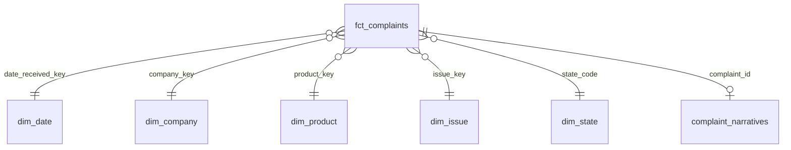
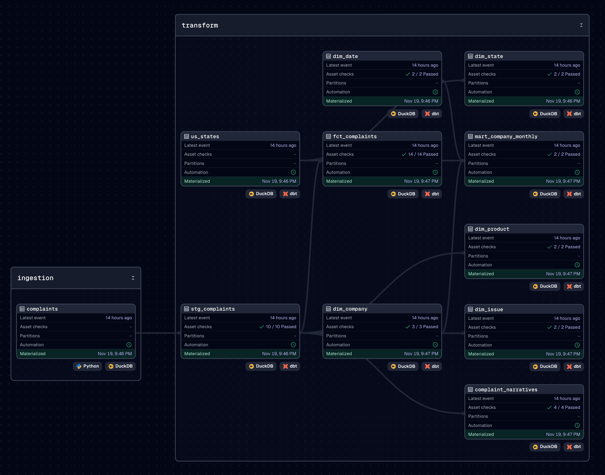

# CFPB Consumer Complaints Data Platform

[](https://github.com/bharatmarimuthu/cfpb-complaints-platform/actions/workflows/ci.yml)

An end-to-end data platform built on the [CFPB Consumer Complaint Database](https://www.consumerfinance.gov/data-research/consumer-complaints/), a public dataset of complaints about U.S. banks and financial companies. The structured fields are updated daily. Free-text consumer narratives stopped being published on 2026-08-14; Phase 6 uses CFPB's archived copies of them.

**Stack:** Python · DuckDB · dbt · Dagster · GitHub Actions · Claude API + scikit-learn · (Streamlit dashboard coming in a later phase)

## Roadmap

| Phase | What | Status |
|---|---|---|
| 1 | Incremental, idempotent ingestion from the CFPB API into a raw layer | ✅ |
| 2 | dbt models: staging → star schema, with data tests | ✅ |
| 3 | Dagster orchestration: schedules, retries, lineage | ✅ |
| 4 | Data quality gates that block bad loads | ✅ |
| 5 | CI/CD with GitHub Actions | ✅ |
| 6 | LLM narrative classification + PII flagging, evaluated against labeled data | 🟡 baseline scored; Claude run pending |
| 7 | Complaint-volume anomaly detection | ⬜ |
| 8 | Dashboard (pipeline health + complaint trends) | ⬜ |

## Quickstart

```bash
python -m venv .venv
source .venv/bin/activate          # Windows: .venv\Scripts\activate
pip install -e ".[dev]"

pytest                              # 38 offline tests (incl. end-to-end Dagster runs)

# Load one week to try it out
python -m cfpb_platform.ingest --start 2026-10-01 --end 2026-10-07

# Then incremental runs (picks its own window)
python -m cfpb_platform.ingest

# Build and test the warehouse models (run from transform/)
cd transform
dbt build                           # seeds, models, 45 data tests, 1 unit test
dbt source freshness                # alerts if ingestion has stalled
dbt docs generate && dbt docs serve # browsable docs + lineage graph
cd ..

# Or run the whole pipeline through Dagster (from the repo root)
mkdir -p .dagster && export DAGSTER_HOME="$PWD/.dagster"   # keeps run history between restarts
dagster dev                         # UI at http://localhost:3000
```

No network? `python -m cfpb_platform.sample_data --rows 5000` loads **synthetic** complaints (with realistic mess) so you can run dbt offline.

Inspect the warehouse:

```bash
python -c "import duckdb; c=duckdb.connect('data/warehouse.duckdb'); print(c.sql('SELECT * FROM meta.ingest_runs'))"
```

## Phase 1: Ingestion

```
CFPB API ──(one day per query, paginated)──▶ client.py ──▶ warehouse.py ──▶ raw.complaints
                                                              │
                                                              └──▶ meta.ingest_runs / meta.ingest_day_log
```

### Tables

- **`raw.complaints`**: one row per complaint, with the API record kept untouched as JSON, plus `record_hash`, `first_ingested_at`, and `last_updated_at`.
- **`meta.ingest_runs`**: one row per run: window, status, row counts, error.
- **`meta.ingest_day_log`**: per-day counts, including whether a day was truncated.

### Design decisions

1. **Raw layer stores untouched JSON.** Cleaning happens later in dbt. If a transformation is wrong, the warehouse can be rebuilt from raw without calling the API again.
2. **Idempotent upserts.** Each record is hashed (SHA-256 over sorted keys). Reloading the same data changes nothing. A row is only rewritten when its content actually changes, and `last_updated_at` shows when that happened.
3. **Lookback window.** Complaints change after they're filed: companies respond, and statuses update. Each incremental run re-pulls the last 14 days (configurable) to catch those changes. The hash comparison keeps it cheap.
4. **Day-sized queries with keyset pagination.** Each query covers one day. CFPB's date filter includes both ends (the spec says the max is exclusive, but the code isn't), so a day is `min = max = d`. The CFPB API ignores `frm` as an offset, so the client pages with `search_after`: each result carries a sort key `[date_ms, id]`, and the client sends the last one back to get the next page. Keyset paging has no 10,000-result depth limit. If a page comes back containing only complaints already seen, the client raises an error instead of looping, which is how a broken cursor shows up.
5. **Watermark only advances on success.** A failed run is recorded with its error and doesn't move the watermark, so the next run retries that window automatically.
6. **Retries with exponential backoff** on network errors and 429/5xx responses.
7. **Offline tests.** A fake API mimics CFPB's real paging behavior, so the tests cover keyset pagination, stalled-cursor detection, truncation, idempotency, change detection, and failure handling without network access.

### Configuration

All settings come from environment variables, with defaults in `config.py`: `CFPB_DB_PATH`, `CFPB_LOOKBACK_DAYS`, `CFPB_BACKFILL_START`, `CFPB_PAGE_SIZE`, and others.

## Phase 2: Transformation (dbt)

```
raw.complaints ──▶ staging.stg_complaints ──▶ marts.dim_*  ──▶ marts.fct_complaints ──▶ marts.mart_company_monthly
   (JSON)            (typed, cleaned view)      (5 dims)         (incremental, contract)
                                          └──▶ marts.complaint_narratives (restricted)
reference.us_states (seed) ─────────────────────┘
```

### Star schema



### Design decisions

1. **Staging does only typing and cleanup.** The CFPB data uses `''`, `"None"`, and `"N/A"` as placeholders; one macro (`clean_text`) turns all of them into real NULLs, so every downstream model handles missing values the same way.
2. **Deterministic surrogate keys.** Dimension keys are an md5 of the natural key, so the fact and dimension tables agree on keys without a lookup join, and keys stay stable across rebuilds.
3. **No NULL foreign keys.** Unrecognized or missing state codes map to an `UNK` member in the dimension, so joins never silently drop complaints.
4. **Incremental fact table.** After the first build, `fct_complaints` reprocesses only complaints whose raw record changed (`last_updated_at` > what's already loaded), using delete+insert on `complaint_id`.
5. **Enforced data contract.** `fct_complaints` declares every column's name and type. If an upstream change alters the shape, the build fails instead of quietly breaking dashboards.
6. **Narratives kept separate.** Free text can contain personal information that CFPB's scrubbing missed, so it lives in `complaint_narratives`, which can be access-restricted while the fact table stays broadly usable. Tagged in dbt metadata (`contains_pii`, `access_tier`). (Since CFPB stopped publishing narratives on 2026-08-14 this table is empty on live data; Phase 6 works from the archive instead.)
7. **Tests are tiered by severity.**
   - **Error (blocks the build):** primary keys unique and not null, every foreign key resolves, no future dates, and a reconciliation test that raw and fact row counts match.
   - **Warn (alerts but doesn't block):** values CFPB might legitimately add later, such as a new `company_response` category or an unrecognized state code.
   - Failing rows are stored in the `test_failures` schema for debugging.
8. **Unit test for cleaning logic.** A dbt unit test feeds a hand-written messy record through `stg_complaints` and checks the exact output.

### Example query

```sql
-- Which companies' complaint volume grew most month over month?
SELECT company_name, month_start, complaints,
       complaints - lag(complaints) OVER (PARTITION BY company_key ORDER BY month_start) AS change
FROM marts.mart_company_monthly
ORDER BY change DESC NULLS LAST
LIMIT 10;
```

## Phase 3: Orchestration (Dagster)

```
raw/complaints ──▶ staging/stg_complaints ──▶ marts/* (9 dbt assets, 41 asset checks)
 (Python asset)          ▲
reference/us_states ─────┘ (seed)

job: daily_refresh (all assets)  ·  schedule: 06:00 America/New_York
```



**First real run (2026-11-19):** `daily_refresh` pulled 711,230 complaints across 33 days (Oct 18 to Nov 19) in 26 minutes, with 0 truncated days and every day's count matching the API's reported total. It inserted 371,376 new complaints and updated 27,534 that had changed since the last load, bringing the warehouse to 1,130,506. `dbt build` then passed all 56 nodes in 30 s. Rerunning an already-loaded day fetched 28,450 records and changed nothing.

Code lives in `src/cfpb_platform/orchestration/`:

- **`assets.py`**: `raw/complaints` wraps `run_ingest`, and `@dbt_assets` turns every dbt seed and model into a Dagster asset.
- **`resources.py`**: the DuckDB warehouse and the CFPB API client, as swappable resources.
- **`definitions.py`**: the `daily_refresh` job, its schedule, and the resource wiring.

### Running it

```bash
dagster dev                                       # from the repo root
```

- **Materialize all** in the asset graph, or launch `daily_refresh` from Jobs, runs ingestion then `dbt build`.
- **Backfills:** to load a specific window, launch `raw/complaints` with run config `{"ops": {"raw__complaints": {"config": {"start": "2026-10-01", "end": "2026-10-07"}}}}`.
- The schedule ships **stopped**, so a plain `dagster dev` never calls the API on its own.

### Running it daily (macOS)

The schedule fires only while a Dagster daemon is running. `scripts/dagster_daemon.sh` installs two LaunchAgents, which start at login and are restarted if they die: a persistent code server on `127.0.0.1:4266`, and the daemon, which reads `dagster_workspace.yaml` to find it. `install` also turns the schedule on:

```bash
conda activate cfpb
scripts/dagster_daemon.sh install      # load both agents and start daily_refresh_schedule
scripts/dagster_daemon.sh status       # agent states, schedule state, last log lines
scripts/dagster_daemon.sh reload       # restart the code server after changing pipeline code
scripts/dagster_daemon.sh uninstall    # stop the schedule and remove both agents
```

- With the agents installed, open the UI with `DAGSTER_HOME=$PWD/.dagster dagster-webserver -w dagster_workspace.yaml` rather than `dagster dev`, which would start a second daemon.
- The code server loads the code once, so run `reload` after editing anything under `src/` or `transform/`.
- Logs are `logs/dagster-daemon.log` and `logs/dagster-code-server.log`.
- If the Mac is asleep at 06:00 ET, the tick fires on wake. Nothing is lost, because each run loads from the watermark up to yesterday.

### Design decisions

1. **Ingestion and dbt are one lineage graph.** The ingestion asset's key is `raw/complaints`, the same key dagster-dbt gives the dbt source `raw.complaints`, so every complaint-derived model is drawn downstream of the API pull. A failed ingestion stops dbt from running on stale data.
2. **dbt tests are asset checks.** `dbt build` runs inside Dagster, so each model's tests run right after it builds, and error-severity failures stop downstream models. Results show on each asset's page.
3. **Two layers of retries.** The HTTP client retries single requests with backoff. On top of that, a Dagster `RetryPolicy` (3 tries, exponential from 60 s) reruns the whole ingestion step, for example if the API is down for several minutes. That's safe because loads are idempotent and a failed run never advances the watermark.
4. **One warehouse path for both tools.** The ingestion code resolves `CFPB_DB_PATH` from the current directory, while dbt's profile resolves it from `transform/`. The Dagster definitions resolve it once to an absolute path and pass it to both, so they always write the same file.
5. **Ingestion logs show up in the run.** The per-day lines from `run_ingest` (`2026-11-10: fetched=28450 inserted=0 updated=0`) are forwarded to Dagster's run log, so progress is visible in the UI during a long backfill.
6. **DuckDB's single-writer lock is respected.** The ingestion asset closes its connection before the dbt step starts, so the dbt subprocess can open the file.
7. **Tested offline.** `tests/test_orchestration.py` runs the real `daily_refresh` assets end to end against a fake API and a temporary warehouse: ingestion, all 9 models, and all dbt tests. It also checks that a rerun inserts nothing.
8. **Dependency pins.** dbt-core 1.11 needs protobuf 6, but the newest `grpcio-health-checking` (a Dagster dependency) needs protobuf 7. `pyproject.toml` pins `protobuf<7` and `grpcio-health-checking<1.76` so both import cleanly.
9. **The daemon runs as a service, not inside `dagster dev`.** A schedule is only as reliable as the process that ticks it. A LaunchAgent keeps the daemon up across logins and crashes without needing a terminal open. The schedule's on/off state lives in the Dagster instance (`.dagster/`), not in code, so the tests and a fresh checkout still start with it off.
10. **One long-running code server instead of one per minute.** By default the daemon starts a fresh gRPC code server every 60 seconds and lets the old one time out. On a laptop that fails during macOS Power Nap: the Mac wakes for a few seconds, the daemon starts a server, and the Mac sleeps again before the server is up. Each of the 10 `DagsterUserCodeUnreachableError` bursts in the daemon log lined up to the second with a `DarkWake` in `pmset -g log`. A separate code-server agent that stays up removes that race and the ~1,400 shutdown warnings it caused, at the cost of a `reload` step after code changes. The server is a plain `dagster api grpc` process rather than `dagster code-server start`. The latter is a proxy that runs the real server as a child, and that child exits after 30 s without a heartbeat. The first wake from hibernate tripped this: the child shut down one second after the wake, the proxy kept running without respawning it, and the 03:00 run was skipped. `api grpc` has no heartbeat by default. If it does exit, launchd's KeepAlive restarts it, which took 3 s when tested with `kill -9`. The scheduler then runs any tick it missed.

## Phase 4: Data quality gates

```
raw/complaints ──▶ [no_truncated_days ✋] [days_match_reported_totals ✋] [fresh ⚠] ──▶ dbt build
                    ✋ blocking: on failure, every dbt model in the run is skipped
                    ⚠ warning only
```

Three Dagster asset checks on `raw/complaints` run after every load and before dbt. They live in `src/cfpb_platform/orchestration/checks.py`.

| Check | Fails when | Effect |
|---|---|---|
| `no_truncated_days` | a day in this load hit `max_records_per_day` and stopped early | blocks dbt |
| `days_match_reported_totals` | a day's fetched count differs from the API's reported total | blocks dbt |
| `fresh` | the newest `date_received` is more than 3 days old | warning |

**First real run (2026-11-25):** the load re-fetched 15 days in 167 s, and all three checks passed in under a second (0 truncated days, 15 of 15 days matching, newest complaint 1 day old). `dbt build` then ran in 53 s.

### Design decisions

1. **The gate sits between the raw load and the marts, not inside ingestion.** Ingestion still writes the raw rows, so nothing fetched is lost, and the next run's lookback re-pulls the bad days anyway. Only the models are held back. A failed check skips every dbt model, so the marts keep the last good build instead of mixing partial days into monthly totals.
2. **The checks read what the load recorded, not the API.** Each day's fetched count, reported total, and truncation flag are already in `meta.ingest_day_log`. The check finds this load's rows through the `run_id` stored in the latest `raw/complaints` materialization, so it costs one query and no API calls.
3. **Count mismatches used to be a log line.** The client already noticed when a day's records differed from the reported total, but it only warned. Now the run stops on it, and the mismatched days and both counts appear in the check's metadata.
4. **Freshness warns instead of blocking.** Stale data is still correct data, and blocking dbt would leave the marts just as stale. The 3-day limit covers CFPB's usual 1-day publishing lag plus a weekend. In the six daily runs from 11-20 to 11-25 the lag was 0 to 1 days.
5. **Thresholds are set from real loads.** Across all 162 loaded days, no day was truncated and none had a count mismatch, so requiring exact equality doesn't produce false failures.
6. **The tests prove the gate actually blocks.** `tests/test_orchestration.py` runs the full pipeline three more ways: with a low per-day cap (truncated days), with a fake API that over-reports one day by 1, and with 6-day-old data. The first two must fail with the raw rows written and no `marts` schema created. The stale run must still build everything. With `blocking=False`, both blocking tests fail.

## Phase 5: CI (GitHub Actions)

`.github/workflows/ci.yml` runs on every push to `main` and on every pull request. No job touches the network beyond installing packages.

| Job | Steps |
|---|---|
| `pytest (Python 3.10, 3.12)` | `dagster definitions validate`, then all 38 tests, including the Dagster end-to-end and quality-gate runs against the fake API |
| `dbt build on synthetic data` | load 5,000 synthetic complaints → `dbt build` → reload the same IDs with changed content → `dbt build` again |

### Design decisions

1. **Offline by design.** The CFPB API is slow (a day of data can take minutes) and isn't reachable from every network, and CI shouldn't depend on a third party being up. The tests use a fake API that mimics the real paging, and the dbt job uses `cfpb_platform.sample_data`, which produces the same kinds of mess the real data has.
2. **Two dbt builds.** The first builds every table from scratch. The second runs after every complaint has changed, so `fct_complaints` takes its incremental delete+insert path. A bug there would otherwise show up only on the live warehouse.
3. **Python 3.10 and 3.12.** `pyproject.toml` claims `>=3.10`, so CI tests the oldest supported version alongside the one used locally.
4. **Definitions are validated separately.** `dagster definitions validate` loads the code location the way the daemon does, so an import or wiring error fails with a clear message instead of as a test error.
5. **Fresh clone, fresh manifest.** CI has no `transform/target/`, so the asset module has to build the dbt manifest itself. That's the path a new contributor takes.

## Phase 6: Narrative classification (Claude) with a baseline

The question: given only the consumer's own words, can a model pick the **product** and **issue** the consumer chose on the CFPB form, and spot personal information the CFPB's `XXXX` scrubbing missed? CFPB's labels are the ground truth.

**Data.** CFPB stopped publishing complaint narratives on 2026-08-14; the live API, CSV export and bulk file no longer have the field. Narratives published before then are in CFPB's [narratives archive](https://www.consumerfinance.gov/foia-requests/foia-electronic-reading-room/cfpb-consumer-complaint-database-narratives-archive/) (FOIA Reading Room), as monthly zip files. This phase uses the July 2026 export: 672,036 complaints, 10,002 with a narrative, 11 products, 118 product/issue pairs. Put the zip files in `data/archive/` (gitignored); more months can be added the same way.

```
archive/narratives -> ml/narrative_split -> ml/narrative_baseline_predictions -> ml/narrative_eval
                                         -> ml/narrative_llm_predictions      ->
```

| Asset | What it does |
|---|---|
| `archive/narratives` | Loads every zip in `data/archive/`, keeping rows with a narrative |
| `ml/narrative_split` | Seeded train/test split, stratified by product (999 test, 9,003 train) |
| `ml/narrative_baseline_predictions` | TF-IDF + logistic regression trained on the train split |
| `ml/narrative_llm_predictions` | Claude labels each test narrative: product, issue, leftover PII types |
| `ml/narrative_eval` | Accuracy, macro-F1, per-class F1 and a product confusion matrix per classifier (`ml.narrative_eval`, `ml.narrative_confusion`) |

### Results (test split, 999 narratives)

| Classifier | Product accuracy | Product macro-F1 | Issue accuracy | Issue macro-F1 | Cost |
|---|---|---|---|---|---|
| TF-IDF + logistic regression | 0.799 | 0.667 | 0.499 | 0.232 | $0 |
| Claude Opus 5.5 (effort `low`) | pending | | | | |

Issue is scored as the (product, issue) pair, since CFPB reuses issue names across products.

### Running it

The `narrative_eval` job runs all five assets. It's manual only and not part of `daily_refresh`.

```bash
export ANTHROPIC_API_KEY=...        # only the Claude step needs it
dagster job execute -m cfpb_platform.orchestration.definitions -j narrative_eval
```

To try the Claude step cheaply first, launch `ml/narrative_llm_predictions` from the UI with config `{"limit": 20}`. The model, effort, cost cap and parallelism are settings on the `narrative_llm` resource (default: `claude-opus-5-5`, `low`, $10, 8 workers).

### Design decisions

1. **A fixed test split, stratified by product.** A seeded hash of the complaint ID picks the test rows, so reruns and other models are scored on the same 999 narratives. Small products still get at least one test row.
2. **A baseline first.** A TF-IDF + logistic regression model trained on the other 9,003 narratives sets the bar. An LLM that can't beat a free model trained on the same data isn't worth its cost.
3. **Structured output with the label list as an enum.** Claude's answer is restricted to CFPB's own products, issues and a fixed set of PII types, so every answer parses and no answer invents a label. Calls that fail (refusal, API error) count as wrong rather than being dropped, so a classifier can't raise its score by skipping hard cases.
4. **The label list sits in a cached system prompt.** The instructions and all 118 labels are identical on every call and marked for prompt caching, so each call pays full price only for the narrative.
5. **A hard cost cap and resumable runs.** Predictions are saved after every wave of parallel calls, keyed by complaint, model and a hash of the prompt. A run stops before it would pass the cap, and the next run continues where it stopped. Changing the prompt or label set changes the hash, so old and new predictions are never mixed.
6. **No database lock during API calls.** DuckDB allows one writer. The Claude step reads its inputs, closes the file, and reopens it only briefly to save each wave, so a long run doesn't block the daily ingestion.
7. **Refusals are handled, not hidden.** On Opus the request opts into Anthropic's server-side fallback, so a safety refusal is retried on another model. The model that actually answered is recorded and priced.
8. **PII flags have no ground truth.** CFPB doesn't label leftover personal information, so the eval reports how often flags fire and by type; flagged narratives get a manual spot check.
9. **Offline tests.** The tests and CI use a keyword classifier in place of Claude, and a fake client to check the exact request (cached system prompt, enum schema, fallback) and response handling (parsing, refusals, pricing). No test calls the API.
10. **The archive may be a sample.** July 2026 has exactly 10,002 narratives (1.5% of complaints), and credit reporting, the largest product overall, has only 463 of them. Results describe this archive, not all complaints.
