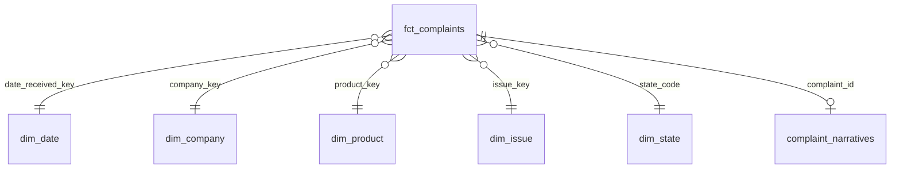

# CFPB Consumer Complaints Data Platform

An end-to-end data platform built on the [CFPB Consumer Complaint Database](https://www.consumerfinance.gov/data-research/consumer-complaints/), a public dataset of complaints about U.S. banks and financial companies. It is updated daily and has both structured fields and free-text narratives.

**Stack:** Python · DuckDB · dbt · Dagster · GitHub Actions · (LLM enrichment, Streamlit dashboard, coming in later phases)

## Roadmap

| Phase | What | Status |
|---|---|---|
| 1 | Incremental, idempotent ingestion from the CFPB API into a raw layer | ✅ |
| 2 | dbt models: staging → star schema, with data tests | ✅ |
| 3 | Dagster orchestration: schedules, retries, lineage | ⬜ |
| 4 | Data quality gates that block bad loads | ⬜ |
| 5 | CI/CD with GitHub Actions | ⬜ |
| 6 | LLM narrative classification + PII flagging, evaluated against labeled data | ⬜ |
| 7 | Complaint-volume anomaly detection | ⬜ |
| 8 | Dashboard (pipeline health + complaint trends) | ⬜ |

## Quickstart

```bash
python -m venv .venv
source .venv/bin/activate          # Windows: .venv\Scripts\activate
pip install -e ".[dev]"

pytest                              # 15 offline tests

# Load one week to try it out
python -m cfpb_platform.ingest --start 2026-10-01 --end 2026-10-07

# Then incremental runs (picks its own window)
python -m cfpb_platform.ingest

# Build and test the warehouse models (run from transform/)
cd transform
dbt build                           # seeds, models, 45 data tests, 1 unit test
dbt source freshness                # alerts if ingestion has stalled
dbt docs generate && dbt docs serve # browsable docs + lineage graph
```

No network? `python -m cfpb_platform.sample_data --rows 5000` loads **synthetic** complaints (with realistic mess) so you can run dbt offline.

Inspect the warehouse:

```bash
python -c "import duckdb; c=duckdb.connect('data/warehouse.duckdb'); print(c.sql('SELECT * FROM meta.ingest_runs'))"
```

## Phase 1: Ingestion

```
CFPB API ──(one day per query, paginated)──▶ client.py ──▶ warehouse.py ──▶ raw.complaints
                                                              │
                                                              └──▶ meta.ingest_runs / meta.ingest_day_log
```

### Tables

- **`raw.complaints`**: one row per complaint, with the API record kept untouched as JSON, plus `record_hash`, `first_ingested_at`, and `last_updated_at`.
- **`meta.ingest_runs`**: one row per run: window, status, row counts, error.
- **`meta.ingest_day_log`**: per-day counts, including whether a day was truncated.

### Design decisions

1. **Raw layer stores untouched JSON.** Cleaning happens later in dbt. If a transformation is wrong, the warehouse can be rebuilt from raw without calling the API again.
2. **Idempotent upserts.** Each record is hashed (SHA-256 over sorted keys). Reloading the same data changes nothing. A row is only rewritten when its content actually changes, and `last_updated_at` shows when that happened.
3. **Lookback window.** Complaints change after they're filed: companies respond, and statuses update. Each incremental run re-pulls the last 14 days (configurable) to catch those changes. The hash comparison keeps it cheap.
4. **Day-sized queries with keyset pagination.** Each query covers one day. CFPB's date filter includes both ends (the spec says the max is exclusive, but the code isn't), so a day is `min = max = d`. The CFPB API ignores `frm` as an offset, so the client pages with `search_after`: each result carries a sort key `[date_ms, id]`, and the client sends the last one back to get the next page. Keyset paging has no 10,000-result depth limit. If a page comes back containing only complaints already seen, the client raises an error instead of looping, which is how a broken cursor shows up.
5. **Watermark only advances on success.** A failed run is recorded with its error and doesn't move the watermark, so the next run retries that window automatically.
6. **Retries with exponential backoff** on network errors and 429/5xx responses.
7. **Offline tests.** A fake API mimics CFPB's real paging behavior, so the tests cover keyset pagination, stalled-cursor detection, truncation, idempotency, change detection, and failure handling without network access.

### Configuration

All settings come from environment variables, with defaults in `config.py`: `CFPB_DB_PATH`, `CFPB_LOOKBACK_DAYS`, `CFPB_BACKFILL_START`, `CFPB_PAGE_SIZE`, and others.

## Phase 2: Transformation (dbt)

```
raw.complaints ──▶ staging.stg_complaints ──▶ marts.dim_*  ──▶ marts.fct_complaints ──▶ marts.mart_company_monthly
   (JSON)            (typed, cleaned view)      (5 dims)         (incremental, contract)
                                          └──▶ marts.complaint_narratives (restricted)
reference.us_states (seed) ─────────────────────┘
```

### Star schema



### Design decisions

1. **Staging does only typing and cleanup.** The CFPB data uses `''`, `"None"`, and `"N/A"` as placeholders; one macro (`clean_text`) turns all of them into real NULLs, so every downstream model handles missing values the same way.
2. **Deterministic surrogate keys.** Dimension keys are an md5 of the natural key, so the fact and dimension tables agree on keys without a lookup join, and keys stay stable across rebuilds.
3. **No NULL foreign keys.** Unrecognized or missing state codes map to an `UNK` member in the dimension, so joins never silently drop complaints.
4. **Incremental fact table.** After the first build, `fct_complaints` reprocesses only complaints whose raw record changed (`last_updated_at` > what's already loaded), using delete+insert on `complaint_id`.
5. **Enforced data contract.** `fct_complaints` declares every column's name and type. If an upstream change alters the shape, the build fails instead of quietly breaking dashboards.
6. **Narratives kept separate.** Free text can contain personal information that CFPB's scrubbing missed, so it lives in `complaint_narratives`, which can be access-restricted while the fact table stays broadly usable. Tagged in dbt metadata (`contains_pii`, `access_tier`).
7. **Tests are tiered by severity.**
   - **Error (blocks the build):** primary keys unique and not null, every foreign key resolves, no future dates, and a reconciliation test that raw and fact row counts match.
   - **Warn (alerts but doesn't block):** values CFPB might legitimately add later, such as a new `company_response` category or an unrecognized state code.
   - Failing rows are stored in the `test_failures` schema for debugging.
8. **Unit test for cleaning logic.** A dbt unit test feeds a hand-written messy record through `stg_complaints` and checks the exact output.

### Example query

```sql
-- Which companies' complaint volume grew most month over month?
SELECT company_name, month_start, complaints,
       complaints - lag(complaints) OVER (PARTITION BY company_key ORDER BY month_start) AS change
FROM marts.mart_company_monthly
ORDER BY change DESC NULLS LAST
LIMIT 10;
```
